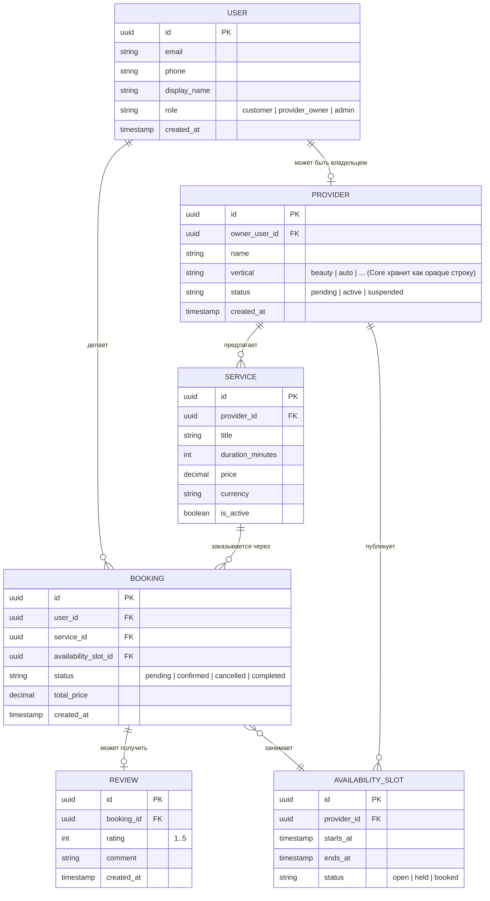

# ERD — Core доменная модель (Phase 1)

Минимальный набор сущностей, общий для любого vertical. Ничего специфичного
для Beauty здесь нет — vertical-модули расширяют эти сущности (например,
`Service` в Beauty получит связанный `master_id`), а не переопределяют их.

## Границы модулей (для владения таблицами)

| Bounded context (Gradle-модуль) | Владеет таблицами |
|---|---|
| `users` | `USER` |
| `providers` | `PROVIDER` |
| `services` | `SERVICE` |
| `booking` | `AVAILABILITY_SLOT`, `BOOKING` |
| `reviews` | `REVIEW` |
| `auth` | учётные данные/токены — отдельно от `USER` (см. ADR ниже) |
| `payments`, `notifications`, `search` | пока без своих таблиц — появятся в Phase 2 |

## Принципиально важное для Core/Vertical границы

- `PROVIDER.vertical` — просто строка, Core её не парсит и не ветвится по
  ней (`if vertical == 'beauty'` в Core-коде запрещено принципом из Factory
  Blueprint).
- Vertical-специфичные атрибуты (например, «мастер» и «портфолио» для
  Beauty) не добавляются как колонки в `SERVICE`/`PROVIDER` — они будут жить
  в отдельных таблицах vertical-модуля, связанных 1:1 по `provider_id`/
  `service_id`. Это первая практическая проверка принципа "Core не знает
  про vertical" на реальной схеме БД.
- `AVAILABILITY_SLOT` смоделирован общим (диапазон времени + статус), а не
  как что-то Beauty-специфичное (например, "слот мастера") — общая
  concept, которую заимствует любой vertical с бронированием по времени.

## Не смоделировано намеренно (см. Factory Blueprint §19)

- Multi-tenant изоляция БД (schema-per-tenant, RLS) — не нужна, пока нет
  второго независимого заказчика/tenant.
- История/аудит (event sourcing, outbox) — достаточно `created_at` полей и
  доменных событий в процессе (см. ADR-0002).
- Отмена/возврат оплаты как отдельная сущность — появится вместе с
  `payments`-модулем в Phase 2.
